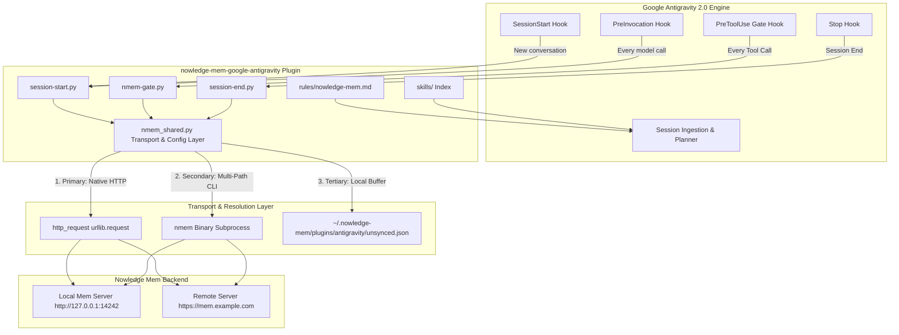
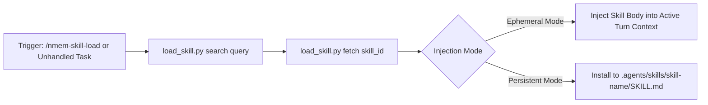

# Nowledge Mem -- Google Antigravity Plugin Architecture

This document details the internal architecture, execution dynamics, transport hierarchy, lifecycle hooks, security gating, and developer integration patterns for the `nowledge-mem-google-antigravity` plugin.

---

Startup reads the scoped context bundle and working memory through their current HTTP routes, with legacy and CLI fallbacks. Child sessions marked by the host skip parent context injection.

## 🏛️ System Architecture Overview

The plugin bridges **Google Antigravity** with **Nowledge Mem** via a hybrid multi-layer transport architecture:

`rules/nowledge-mem.md` declares `trigger: always_on`; rule activation is separate from lifecycle hook execution. Without a valid trigger, Antigravity does not apply the rule even when hooks and skills load.



---

## 🔄 Lifecycle Hook Dynamics

### 1. SessionStart and PreInvocation Hooks (`hooks/session-start.py`)
- **SessionStart trigger**: Antigravity runs it once when a new conversation starts, including each subagent conversation. It does not run again on later turns or when a conversation is resumed.
- **Execution Flow**:
  1. Queries the Nowledge Mem backend via `nmem_shared.http_request("/context?source_app=google-antigravity")`.
  2. If Context Bundle is unavailable, falls back to `/working-memory`.
  3. Emits `injectSteps` with one `systemMessage` step containing a `<nowledge_context_bundle>` block. A `systemMessage` stays in the conversation for later model calls and turns; the deprecated `ephemeralMessage` is dropped after the first model call.
  4. Launches a background retry daemon (`python3 session-start.py --retry-only`) to flush any pending unsynced sessions from `~/.nowledge-mem/plugins/antigravity/unsynced.json`.
- **PreInvocation trigger** (`session-start --pre-invocation`): runs before every model call. It syncs approved `learning_proposal.md` artifacts and never injects the startup context. `invocationNum` in its payload restarts at `0` on every user turn, so it cannot identify the first turn of a conversation.

### 2. PreToolUse Gate Hook (`hooks/nmem-gate.py`)
- **Trigger**: Evaluated before executing `call_mcp_tool`, `mcp_nowledge-mem_*`, or `run_command`.
- **Policy Enforcement**:
  - **Unreadable Call**: a payload the gate cannot read as a named tool call (empty stdin, invalid JSON, no tool name, bytes that are not UTF-8) returns `{"decision": "force_ask"}`, because the gate cannot tell a delete from a read. Like every hook, the gate reads stdin through `nmem_shared.read_hook_payload()`, which reads bytes and decodes UTF-8 itself because Windows decodes a piped stdin with the locale code page. The lifecycle hooks read through `read_hook_input()`, which gives them `{}` for a payload it cannot read.
  - **Auto-Allow**: Read-only tools (`memory_search`, `thread_search`, `query_library`, `explore_graph`, `get_memory_by_id`, `ontology_read`, `entity_search`, `list_timeline_reviews`, `visibility_reason`, `memory_identity_read`, `read_skill`, read-only `entity_aliases`, etc.) return `{"decision": "allow"}` with permission overrides to prevent prompt interruptions; validated status commands (`python3 hooks/nmem_status.py`, `python3 hooks/nmem_entrypoint.py status`, `nmem status`, `nmem tasks`) return `{"decision": "allow", "reason": "..."}`.
  - **Force Confirm**: Destructive operations (`memory_delete`, `thread_delete`, `memory_relation_delete`, `entity_delete`, `label_delete`) return `{"decision": "force_ask"}`.
  - **Intent-Based Write Allow**: Write tools (`memory_add`, `memory_update`, etc.) check recent conversation steps for intent keywords (`save`, `remember`, `store`, `nmem`, `distill`, `handoff`). If found, returns `{"decision": "allow"}`.
  - **Nowledge FS (`mem_fs`)**: one tool that reads, writes and deletes, so the gate classifies each call by the first word of the `command` the server will run: the top-level `command` of `mcp_nowledge-mem_mem_fs`, or `Arguments.command` of a `call_mcp_tool`, which forwards only `Arguments`.
    - `ls`, `cat`, `stat`, `find`, `grep`, `recall`, `capabilities` and `caps` return `{"decision": "allow"}` without a permission override, because an override would cover the tool's writes as well.
    - `rm` and `delete` return `{"decision": "force_ask"}`, like the other deletes.
    - `write` follows the intent check for write tools.
    - Anything else, including a missing, empty or unparseable command, returns `{"decision": "force_ask"}`: the server parses the command itself and may still read it as a delete.
  - **Memory Health Catchup Debounce & Gating**: `trigger_memory_catchup` checks for prior execution in the current session directory (`<session_dir>/.nmem/catchup_history.json`) and a 1-hour global cooldown. Redundant calls are auto-suppressed with an explanation; new calls require explicit user maintenance intent (`catch up`, `rescore`, `decay`, `compaction`, `maintenance`) to auto-allow or prompt confirmation.

### 3. PostInvocation Hook (`hooks/post-invocation.py`)
- **Trigger**: Runs after each model invocation completes.
- **Execution Flow**:
  1. Checks for pending unsynced offline sessions (`~/.nowledge-mem/plugins/antigravity/unsynced.json`) via `nmem_shared.get_unsynced_sessions()`.
  2. If at least one pending item is due (`has_due_unsynced_sessions`, i.e., past its `next_retry_at` exponential backoff deadline), spawns an asynchronous background worker (`nmem_shared.retry_unsynced_sessions_async()`) to drain due entries.
  3. Throttles warning notifications to at most once per conversation session (`should_emit_unsynced_warning`), emitting `injectSteps` with an informational message clarifying that background sync is in progress and `trigger_memory_catchup` is not required. Session warning state is tracked locally in `<session_dir>/.nmem/warning_history.json`.

### 4. Stop Hook (`hooks/session-end.py`)
- **Trigger**: Runs when the Antigravity session terminates.
- **Execution Flow**:
  1. Reads `conversationId`, `transcriptPath`, and `fullyIdle` from stdin.
  2. If `fullyIdle: false` (background tasks still running), skips thread capture and defers to the final idle stop.
  3. Extracts user prompts (`USER_EXPLICIT`) and model responses (`MODEL`). Derives the title from the first prompt, unwrapping Antigravity and T3 Code metadata before collapsing whitespace and taking up to 60 characters.
  4. Checks thread existence via `HTTP GET /threads/<id>` (or `limit=0` metadata lookup for long threads) or `nmem t show`. When a verified local sync checkpoint (`~/.nowledge-mem/plugins/antigravity/cache/thread_sync_checkpoints.json`) matches the local prefix SHA-256 hash and server metadata (`total_messages`, `storage_id`, `created_at`, `space_id`), confirms the bounded 32-message tail window (content and recorded message IDs) in O(1). For unknown histories or any checkpoint mismatch, scans forward from `offset=0` in bounded 32-message pages (on both HTTP and CLI fallback) to locate the exact first differing row without single-request full-thread downloads.
  5. For pure suffix growth (`matched_count == total_messages`), sends only the new messages via `POST /threads/<id>/append` with `expected_message_count` and a deterministic `idempotency_key` (or `nmem t append --idempotency-key` in CLI fallback), then verifies persistence across the bounded write-start and 32-message tail windows and updates the local checkpoint. When stored history diverges after a matching prefix, uses `POST /threads/<id>/reconcile-tail` on HTTP to replace from the exact first differing row (or fails closed on CLI fallback); divergent histories with no matching prefix fail closed without appending duplicates.
  6. If backend calls fail, saves the session to `~/.nowledge-mem/plugins/antigravity/unsynced.json` via file-locked append for automatic background retry.
  7. Scans for approved `learning_proposal.md` artifacts and syncs them to rules (`nmem rules upsert`), skills (`nmem skills enroll`), or memories (`nmem memories add`).

### 5. Session Directory State Isolation (`.nmem/`)
- Rather than persisting session-level state into the global `~/.nowledge-mem/` configuration folder, hooks isolate session-scoped metadata within `<session_dir>/.nmem/` (resolved from `artifactDirectoryPath` or `transcriptPath`):
  - `<session_dir>/.nmem/catchup_history.json`: Tracks per-horizon catchup executions within this session.
  - `<session_dir>/.nmem/warning_history.json`: Tracks notification emissions for offline sync warnings to prevent repeating alerts in active conversations.
  - Empty `unsynced.json` markers are removed after retry. Malformed queue files are moved beside the queue as `unsynced.corrupt-<timestamp>.json` so user sessions remain recoverable rather than being discarded. Repeated retry failures record `retry_count`, `next_retry_at` (exponential backoff starting at 30s, capped at 3600s), and `last_error`; sessions that exhaust `UNSYNCED_MAX_RETRIES` (5) or fail with permanent `divergent_history` are atomically isolated into `~/.nowledge-mem/plugins/antigravity/dead_letter.json` before removal from `unsynced.json`.

### 6. Interpreter Floor & Failure Fallbacks
- Hooks run on whatever `python3` (then `python`) the host provides. On macOS that is the Command Line Tools Python 3.9, so hook and skill code stays compatible with Python 3.9: modules that use `X | None` annotations start with `from __future__ import annotations` (enforced by ruff `FA`), and 3.10+ APIs such as `zip(strict=)` are not used. CI runs `tests/test_hooks.py` on Python 3.9.
- `hooks/nmem_entrypoint.py` decides who answers when a hook cannot run:
  - **Before the hook starts** (interpreter older than 3.9, or the hook module fails to import), nothing has read stdin yet. The process exits 1 with the cause on stderr (the entrypoint's own message for an old interpreter, a traceback for an import error), so `hooks.json` tries `python` next and then its `echo` fallback.
  - **Once the hook is running**, it may already have consumed stdin, so re-running it under `python` would see an empty payload. A failure there is answered with the hook's fallback (`{"decision": "force_ask", "reason": "..."}` for PreToolUse, `{}` otherwise) and exit 0, unless the hook already wrote its reply.
- The final `echo` in each `hooks.json` chain answers when no interpreter can run the hook. Antigravity aborts the tool call when it cannot parse a PreToolUse reply, so that fallback is single-quoted (`echo '{"decision":"force_ask"}'`) to keep its double quotes through POSIX shell quote removal.
- Both PreToolUse fallbacks answer `force_ask`. Neither can tell a delete from a read, and only `force_ask` still prompts when the user chose Always Allow, as the gate does for deletes. The cost is that while hooks cannot run, every terminal command and MCP call the hook matches asks for approval each time; a healthy gate passes unrelated tools with `allow`.

---

### Bridge SessionStart

The separate Bridge `SessionStart` group runs `hooks/bridge-start.py` through the shared entrypoint. When enabled alongside an approved `NMEM_AGENT_CONTEXT`, it emits one ephemeral instruction. The agent uses the CLI to verify the Context and check one page in its exact Space. Interactive identity-wide CLI reads retain the original Space on each message. The bundled skill also documents exact-Space Remote MCP calls for explicit interactive requests.

## ⚙️ Configuration & Path Resolution Hierarchy

### Config Resolution Order
`hooks/nmem_shared.py` resolves connection settings using the following precedence:
1. **Environment Variables**: `NMEM_API_URL` and `NMEM_API_KEY`.
2. **Local Workspace Config (`.config.json`)**: Reads `.config.json` at workspace root (or plugin root) (`apiUrl` / `api_url` and `apiKey` / `api_key`).
3. **Plugin Storage Config File**: `~/.nowledge-mem/plugins/antigravity/config.json` (persists plugin-specific configuration defaults across updates).
4. **Global Client Config File**: `~/.nowledge-mem/config.json` (`apiUrl` and `apiKey`).
5. **Default Fallback**: `http://127.0.0.1:14242` (default local loopback).

### Multi-Path System Binary Resolution
To ensure subshells running inside sandboxed tool environments (`BypassSandbox: false`) can locate the `nmem` binary when user `$PATH` symlinks are hidden, `_nmem_command()` checks paths in order:
1. PATH lookup via `shutil.which("nmem")` (dereferencing symlinks to verify existence).
2. Canonical Linux package paths:
   - `/usr/lib/nowledge-mem/nmem`
   - `/usr/lib64/nowledge-mem/nmem`
   - `/usr/local/bin/nmem`
   - `/usr/bin/nmem`
   - `~/.local/share/nowledge-mem/bin/nmem-wrapper`

### Space Resolution & Verification Pipeline
Antigravity runs hook commands from the directory containing `hooks.json` and
provides the opened project roots as `workspacePaths` in every hook payload.
Each lifecycle entrypoint binds the shared resolver and HTTP transport to that
payload root before reading configuration. In a multi-root payload, the resolver
uses the root containing `transcriptPath`; otherwise it preserves the host's
first-root ordering. The interactive `nmem-status` skill passes its command cwd
explicitly with `--workspace-root .`.

`hooks/nmem_shared.py` then resolves the active space using
`resolve_space(cwd=None)` following this pipeline:
1. **Explicit Environment Variables**: Returns `NMEM_SPACE` or `NMEM_SPACE_ID` if explicitly set by user.
2. **Local Workspace Configuration (`.config.json`)**: Reads `space` or `space_id` from `<workspace_root>/.config.json`.
3. **Explicit Workspace Configuration Files**: Returns explicit `space` defined in `.nmemspace` or `.nowledge/config.json` at the workspace root.
4. **Plugin Root Configuration (`.config.json`)**: Reads `space` or `space_id` from `<plugin_root>/.config.json` if distinct from workspace.
5. **Plugin Storage Configuration**: Returns `space` or `space_id` defined in `~/.nowledge-mem/plugins/antigravity/config.json`.
6. **Global Client Configuration**: Returns `space` or `space_id` defined in `~/.nowledge-mem/config.json`.
7. **Dynamic Space Auto-Detection with Existence Verification**:
   - Infer candidate space name from workspace directory basename (e.g. `Path(cwd).name`).
   - Query existing backend spaces (`get_existing_spaces()`) via `/spaces` HTTP GET or `nmem --json spaces list`.
   - Match candidate against `id`, `key`, `name`, or `aliases`.
   - If candidate space exists, use it.
8. **Fallback to Default Space**: If the dynamically detected space does NOT exist on the backend and the user has not explicitly configured a project space, fall back to `"default"`.

Workspace declarations are strict at lifecycle boundaries. Malformed explicit
files and explicit Spaces absent from a reachable server raise a visible
configuration diagnostic and prevent Default-space writes. Backend outages are
different: the declared Space is retained so Stop can queue the session with its
intended destination. Environment Space overrides still take precedence.

---

MCP configuration synchronization resolves and validates the active Space, then emits `X-Nmem-Space-Id`. Explicit invalid Spaces must not overwrite the connection with Default. In the default `auto` mode (`NMEM_MCP_SYNC_MODE` / `mcpSyncMode`: `auto` | `managed` | `off`), `sync_mcp_config_file()` checks Antigravity's host global (`~/.gemini/config/mcp_config.json`, skipped when `NMEM_IGNORE_HOST_CONFIG=1`) and workspace (`.agents/mcp_config.json`) MCP configs first; when a distinct host config already defines `mcpServers.nowledge-mem`, the plugin defers without recreating a deleted plugin `mcp_config.json` and removes `nowledge-mem` from an existing plugin `mcp_config.json` (preserving other servers) to avoid duplicate loading or overriding host policies such as `disabledTools`. The generated plugin configuration is shared on disk; simultaneous workspaces using different Spaces require host-level per-session connections and are not isolated by this file.

Do not opt into the `exact-v1` protocol without backend capability negotiation: local backends requiring migration reject it. The Space header selects the existing configured retrieval policy, which may include shared Default memories.

## 🚀 Interface Selection Guidelines for Agents & Developers

To minimize user prompt friction and context bloat, select the appropriate transport for each capability:

| Access Path | Recommended Surface | Rationale |
| :--- | :--- | :--- |
| **In-Session Agent Actions** | Native MCP (`mcp_nowledge-mem_*`, `mem_fs`) | Schema-validated, low latency, **does not trigger terminal permission prompts**. |
| **Knowledge Navigation** | Nowledge FS (`mem_fs`) | Path-first navigation (`/memories`, `/threads`, `/wiki`). Allows `stat` checking before `cat` windowed reading (`--line`, `--lines`). |
| **Background Hooks & Scripts** | Native Python HTTP (`nmem_shared.http_request`) | Direct REST API calls via `urllib.request` (<30ms execution) bypass subprocess spawn overhead. |
| **Diagnostics & CLI Fallback** | `nmem` CLI | Shell commands for terminal diagnostics (`nmem status`). Requires **positional arguments** (`nmem fs recall "<query>"`, `nmem fs cat "<path>"`). |

---

## 🧩 Dynamic Skill Loader Architecture (`nmem-skill-load`)

The `nmem-skill-load` skill allows Antigravity to dynamically search, preview, and load candidate/compiled skills from Nowledge Mem:



- **Slash Command**: `/nmem-skill-load <query>`
- **Proactive Discovery**: Triggered automatically when Antigravity detects an unhandled domain task (Makefile, RPM packaging, Flatpak, Docker) with an available skill definition on the Nowledge Mem server.
- **Modes**:
  - **Ephemeral Mode (Zero-Restart)**: Ingests the fetched skill body directly into the active turn context for immediate execution without writing files to disk.
  - **Persistent Mode**: Installs the skill file to `<workspace-root>/.agents/skills/<skill-name>/SKILL.md` (and appends entries to `.git/info/exclude` if requested).

---

## 🧪 Testing & Validation

Run unit tests and plugin manifest verification:

```bash
# Run hooks unit test suite
python3 -m unittest discover -s tests -p "test_*.py"

# Run container integration test suite against nowledgelabs/mem on a random host port
python3 -m pytest -v tests/integration/

# Validate manifest, configuration files, and release assets
node scripts/validate-plugin.mjs
```

## Local Bridge notice consumer

`bridge-notice.py` runs only for `PreInvocation` with `invocationNum == 0` and an actual `conversationId`. It reuses the shared bounded Python observer-cache consumer and injects its hint as `systemMessage`. No CLI subprocess or mailbox network request runs on this path. The local ledger deduplicates observer tokens; stale, disabled, missing or differently bound snapshots remain silent. Host correlation does not grant identity authority. `bridge-start.py` offers conditional subscription guidance only under the existing startup opt-in and approved Context gate.
